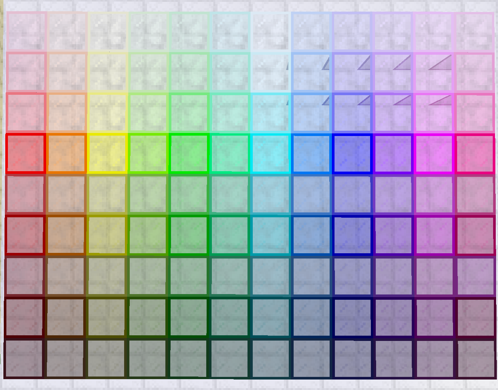

# Doyousketch2's Stained Glass mod

This Luanti/Minetest mod adds plenty of stained glass nodes.

 * Forum topic: https://forum.luanti.org/viewtopic.php?t=4904
 * ContentDB: https://content.luanti.org/packages/andersje/stained_glass/

License: See [LICENSE](LICENSE)

## Authors

Originally developed by Eli Innes/Doyousketch2, and distributed
under GPL v2.  Further changes by VanessaE (removing from creative inventory)
and Jeremy Anderson (fixing craft recipes, renaming blocks)

Maintained by the Minetest Mods Team.

## Dependencies

 * default (provided by Minetest Game or alike games)
 * [unifieddyes](https://github.com/mt-mods/unifieddyes)
 * [moreblocks](https://github.com/minetest-mods/moreblocks)

Manual installation instructions: https://docs.luanti.org/for-players/installing-mods/

## Glass types

To turn off types of glass, alter [`settings.txt`](settings.txt) in the stained_glass directory.

Default settings:

	-- Based on moreblocks' super_glow_glass
	stained_glass.full_light = true
	-- Based on moreblocks' glow_glass
	stained_glass.med_light = true
	-- Based on default' default:glass
	stained_glass.no_light = true
	-- Based on moreblocks' trap_super_glow_glass
	stained_glass.trap_full_light = true
	-- Based on moreblocks' trap_glow_glass
	stained_glass.trap_med_light = true
	-- Based on moreblocks' trap_glass
	stained_glass.trap_no_light = true

Feature: Liquids can flow through trap stained glass -- making illuminated waterfalls a possibility.

### Craft recipes

All recipes produce three glowing stained glass blocks.

Standard colors:

	dye
	super glow glass
	super glow glass
	super glow glass

Pastel colors:

	light dye
	white paint
	super glow glass
	super glow glass
	super glow glass

Faint colors:

	light dye
	white paint
	white paint
	super glow glass
	super glow glass
	super glow glass

### Color palettes

The Palette includes:

	red, orange, yellow, lime, green, aqua
	cyan, skyblue, blue, violet, magenta, redviolet

Full and half-saturation, medium and dark shades have been included
as well as light, pastel, and faint tints.

#### Node naming

**Normal nodes** use the format `stained_glass:<C>_<B>_<S>`.

 * `<C>` color number according to table `stained_glass_hues`
 * `<B>` brightness number according to table `stained_glass_shades`
    * dark   = 3
    * medium = 4
    * full   = 5
 * `<S>` saturation number:
    * 50%    = 6
    * full   = 7

Examples:

 * "Red, dark 50%" is `stained_glass:11_3_6`
 * "Blue, medium full-saturation" is `stained_glass:7_4_7`

**Bright nodes** use the format `stained_glass:<C>_<H>`.

 * `<H>` hue number:
    * light  = 8
    * pastel = 9
    * faint  = 91

Examples:

 * "Violet, light" is `stained_glass:8_8`
 * "Orange, faint" is `stained_glass:12_91`
